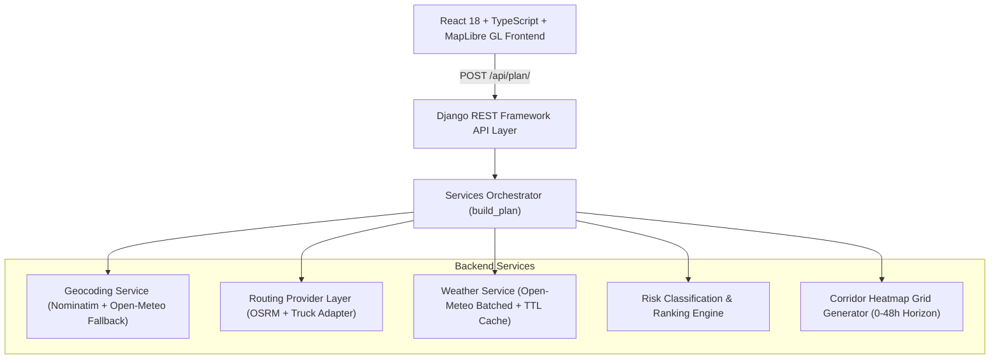

# Spotter Weather-Aware Truck Routing — Architecture Document

## 1. System Overview

Spotter Weather-Aware Truck Routing is a high-reliability, full-stack dispatch advisory system that calculates alternative driving routes between commercial freight hubs, samples spatial checkpoints at uniform intervals, retrieves time-aligned atmospheric forecasts, applies load-dependent commercial trucking safety rules, and renders an interactive geospatial route comparison and spatial weather heatmap.



---

## 2. Backend Architecture

The backend is built with **Python 3.12+**, **Django 5.2**, and **Django REST Framework (DRF)**, structured cleanly into decoupled single-responsibility modules:

### 2.1 Routing Provider Abstraction (`routing/routing_provider.py`)
- Defines the `RoutingProvider` abstract base class with standard contract:
  `get_routes(origin: dict, destination: dict) -> List[Dict[str, Any]]`
- **`OSRMProvider`**: Uses the Open Source Routing Machine driving API. Configured with resilient retry logic, exponential backoff, browser-compliant User-Agent headers, and route deduplication.
- **`CommercialTruckRoutingProviderAdapter`**: Enterprise adapter documenting parameters required for commercial truck routing (gross vehicle weight, axle count, height/width clearances, hazmat placards) for providers like HERE Fleet Telematics or Mapbox Truck.
- **Route Deduplication (`deduplicate_routes`)**: Eliminates redundant or near-identical paths where distance and duration match within 1.5% and midpoints overlap geographically.

### 2.2 Geocoding Engine with Automatic Fallback (`routing/geocoding.py`)
- **Primary Provider:** OpenStreetMap Nominatim with strict RFC-compliant User-Agent headers.
- **Fallback Provider:** Open-Meteo Geocoding API (`https://geocoding-api.open-meteo.com/v1/search`), instantly invoked if Nominatim returns HTTP 403, 429, 503, or times out.
- **In-Memory Cache:** Avoids repeated external network lookups for common origin/destination strings.

### 2.3 Batched Weather Service (`routing/weather_service.py`)
- Interfaces with **Open-Meteo Forecast API**.
- **Multi-Coordinate Batching:** Packages up to 30 coordinates into single multi-point queries (`latitude=lat1,lat2&longitude=lon1,lon2`), avoiding sequential HTTP overhead.
- **In-Memory TTL Cache:** Caches rounded coordinate hourly forecasts `(round(lat, 2), round(lon, 2))` for 15 minutes.
- **Unit Precision:** Queries Open-Meteo with `wind_speed_unit=mph` and `precipitation_unit=inch`, eliminating previous unit-conversion division bugs.
- **Temporal Interpolation:** Aligns checkpoint arrival times (ETAs in UTC) with hourly forecast slots, interpolating between hours when arrivals fall mid-hour.

### 2.4 Risk Evaluation & Multi-Dimensional Ranking (`routing/risk.py`)
- Deterministic threshold implementation:
  - **Wind (mph):** Low (<25), Moderate (25–34), High (35–44), Severe (45–54), No Travel (55+)
  - **Rain (in/hr):** Low (<0.10), Moderate (0.10 to <0.25), High (0.25 to <0.50), Severe (0.50–1.00), No Travel (>1.00)
  - **Snow (in/hr):** Low (<0.50), Moderate (0.50 to <1.00), High (1.00 to <2.00), Severe (2.00–3.00), No Travel (>3.00)
- **Load-Dependent Wind Rules:**
  - Wind 45–54 mph and cargo load > 30,000 lbs => **No Travel**
  - Wind 35–44 mph and cargo load > 40,000 lbs => **Severe**
- **Route Ranking Priority:**
  1. Paths free of No Travel conditions
  2. Lowest Severe hazard mileage
  3. Lowest High hazard mileage
  4. Lowest distance-weighted average risk index
  5. Driving duration
  6. Total distance

### 2.5 Corridor Heatmap Generator (`routing/corridor_service.py`)
- Generates a 2D bounding grid (~16-24 sample stations) enclosing the travel corridor.
- Fetches 48-hour forecasts for all grid stations in a single batched Open-Meteo call.
- Precomputes 17 temporal frames (every 3 hours: +0h, +3h, +6h, ..., +48h).
- Assigns spatial risk intensity weights (0.15 for Low up to 1.00 for No Travel) for GPU-accelerated MapLibre GL rendering.

---

## 3. Frontend Architecture

The frontend is a modern **React 18** Single Page Application built with **TypeScript** and **Vite**, structured into reusable component modules:

```
frontend/src/
  ├── types/               # Domain data models (TripPlan, TripRoute, Checkpoint, etc.)
  ├── services/            # API client with typed fetch and structured ApiError handling
  ├── hooks/               # Custom state management (useRoutePlanner)
  ├── utils/               # Constants (RISK_COLORS, MAP_STYLES)
  ├── components/
  │   ├── common/          # Sidebar, Header, ErrorBanner
  │   ├── routing/         # TripPlannerForm, RouteCard, RouteComparisonList
  │   ├── weather/         # WeatherTimelineSlider, WeatherInsightsPanel, HazardLegend
  │   └── map/             # MapView (MapLibre GL layers, popups, heatmap radar)
  ├── App.tsx              # Master view layout
  └── main.tsx             # Application mount point
```

### 3.1 MapLibre GL Integration
- **Route Polylines:** Interactive GeoJSON LineStrings with distinct color coding (`#32cfc1` for selected, `#556f80` for alternatives).
- **Waypoint Markers:** Dual-layer circles (soft blur halo + solid risk-colored core). Clickable with rich metadata popups showing ETA, wind speed, rain, snow, and hazard factors.
- **Origin & Destination Pins:** Custom SVG badges highlighting departure and arrival terminals.
- **Spatial Heatmap Overlay:** Native MapLibre `heatmap` layer rendering continuous, dynamic risk gradients driven by the 0–48h timeline slider.

---

## 4. Security & CORS Architecture
- Strict environment variable handling via `python-dotenv` and Docker environment variables.
- CORS configured with `django-cors-headers` allowing local development (`localhost:5173`, `127.0.0.1:5173`) and Vercel domains (`spotter-weather-routing.vercel.app` and preview branch regexes).
- No sensitive keys or credentials committed to source control.
